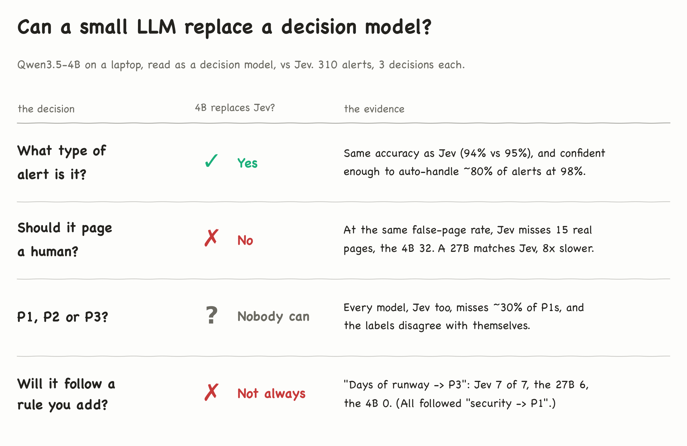
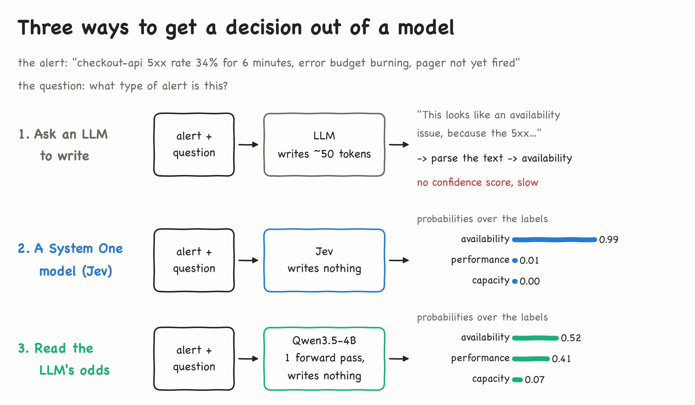
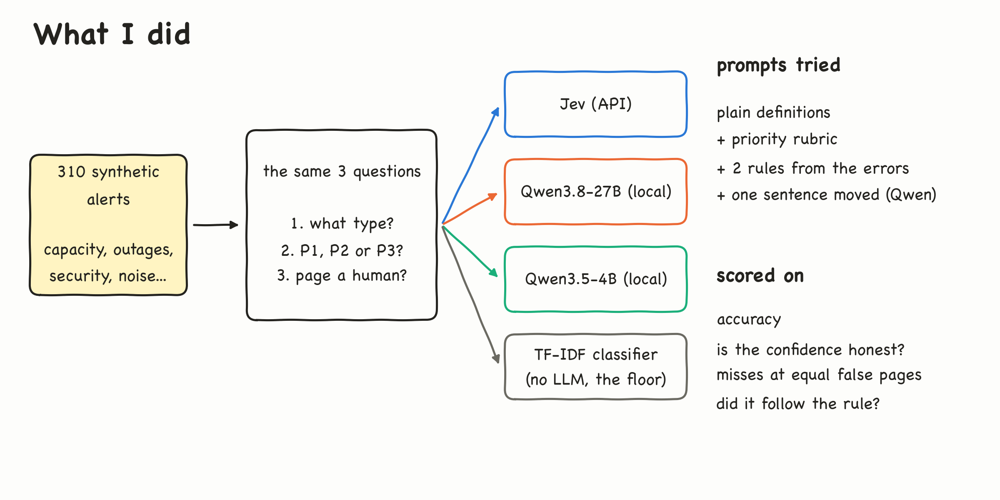
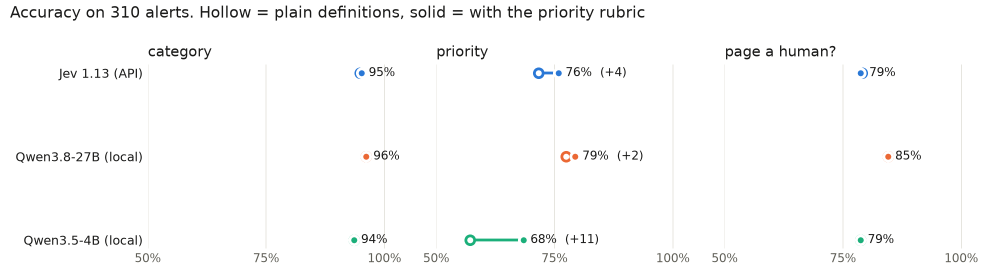
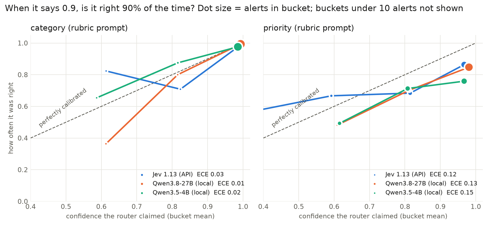
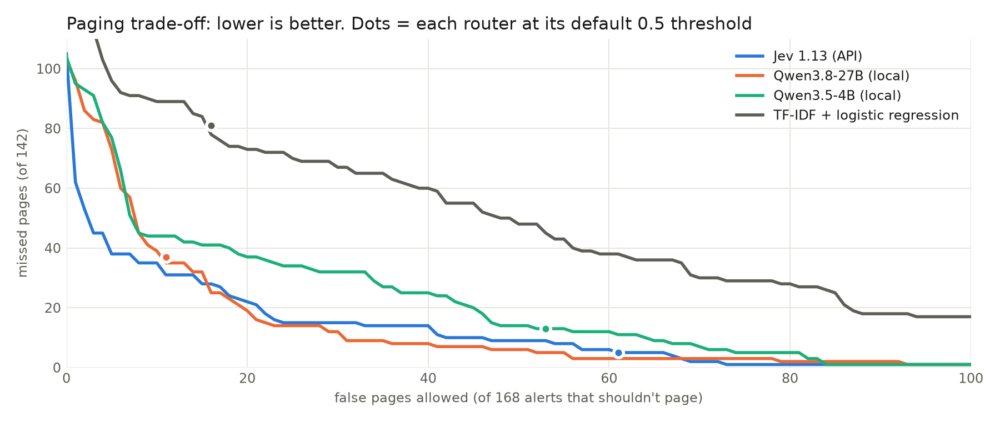
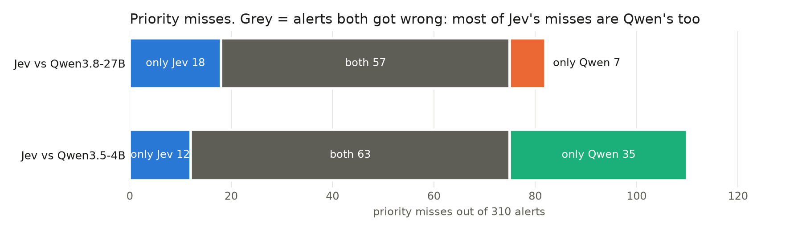
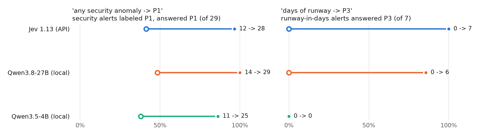
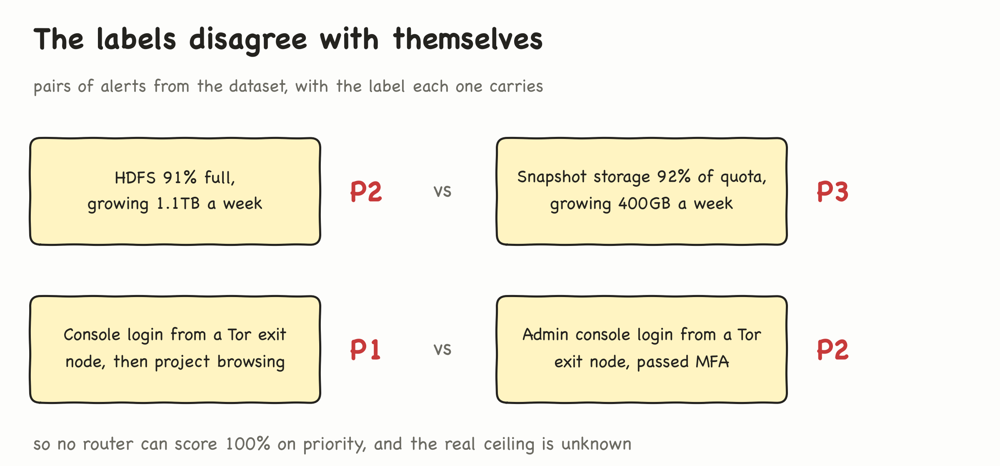
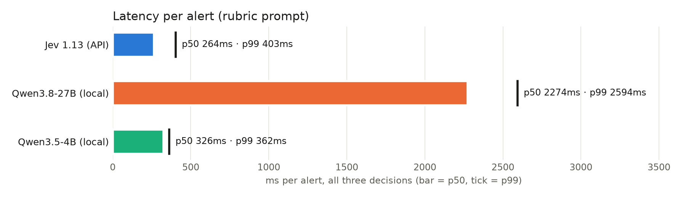

# Do you need a decision model? Qwen3.5-4B and Qwen3.8-27B vs Jev on 310 alerts

**The question.** Jev is a dedicated "decision model": you ask it a typed
question and it returns probabilities, never text. Can an ordinary small LLM
do the same job if you read its probabilities directly?

**The test.** Qwen3.5-4B on my laptop (plus Qwen3.8-27B as a bigger
reference) against Jev's API, on 310 synthetic ops alerts. Three decisions per
alert: what type of alert is it, P1/P2/P3, and should it page a human?

**What you'll get.** Which decisions a small LLM can take over (one of the
three), where it falls short and why, and five checks to run before you trust
any model with decisions like these.

*The answer, one decision per row.*

Last month I tested [Jev](https://suryal.dev/articles/jev-vs-qwen3-8-27b-vs-claude-sonnet-5.html),
TypeSafe's "System One" model. It can't write a sentence. You send it state
plus typed questions, and it returns probabilities. It routed my alerts about
as well as the LLMs I compared it with, at about a tenth of their latency.
Those LLMs were a 27B and Claude Sonnet *generating text*, though, not a small
model used the same way Jev is.

Since then I've seen people use ordinary LLMs for this job, and it makes sense:
an LLM already computes a probability for every possible next token. Why not
read those directly and skip the separate model?

*One real alert. Way 1 is how most people use an LLM for routing. Way 3 is
this experiment: Qwen never writes a word, I read how much probability it
puts on each label. Here the 4B got it right but put 0.41 on "performance",
which a text answer would hide.*

## What I thought

Three things, in the order I believed them:

1. **A small local LLM, read this way, can replace Jev.** Same answer shape,
   same latency, no API.
2. **Priority is the hard one, and a written rubric fixes it.** Plain
   one-line definitions of P1/P2/P3 leave too much to guess.
3. *(After seeing the errors.)* **The remaining priority errors are a missing
   policy, not a weak model.** Write the two missing rules down and every
   model improves.

The first held for one decision out of three. The second helped a little.
The third failed when I tested it.

## What I did

- **Data:** the same 310 synthetic alerts as last time. 10 seed alerts were
  written by hand for the first experiment; Claude generated and labeled the
  other 300 in three batches (data platform, infrastructure, streaming).
  The priority section shows why those labels need a hand check.
- **Questions:** category (5 types), priority (P1/P2/P3), and "page a human?"
  (yes/no). Jev and Qwen get identical wording, from one file.
- **Routers:** Jev 1.13 over its API, Qwen3.5-4B and Qwen3.8-27B on a local
  M5 Max, and a TF-IDF + logistic regression classifier as a no-LLM floor
  (5-fold cross-validation). *(The version numbers are right: Qwen3.5 is the
  newest small Qwen; 3.6 and 3.8 only ship at 27B and up.)*
- **Prompts:** plain definitions; a written priority rubric; the rubric plus
  two rules taken from the errors; and one sentence moved, to test how
  sensitive the small model is to wording.

**How the probabilities are read.** Every label is a single token in Qwen's
tokenizer (`capacity`, `security`, `yes`, `no`...), and the runner refuses to
start if that isn't true. P1/P2/P3 tokenize as `P` + digit, so the prompt
ends in `P` and I read the digit. I take the top-50 next-token
probabilities, keep the allowed labels (summing `yes`/`Yes` and `no`/`No`),
and renormalize. On average over 99% of the probability already sits on a
valid label, and never less than 84% for any decision.

## What I found

| rubric prompt | category | priority | page a human | p50 per alert |
|---|---|---|---|---|
| Jev 1.13 (API) | 95% | 76% | 79% | 264ms |
| Qwen3.8-27B (local) | 96% | 79% | 85% | 2,274ms |
| Qwen3.5-4B (local) | 94% | 68%* | 79% | 255–446ms |
| TF-IDF + logistic regression | 80% | 57% | 69% | <1ms |

*Hollow dot = plain definitions, solid = with the rubric. \*The rubric puts
its tie-break sentence before the P1/P2/P3 list, the same structure Jev gets.
With the sentence after the list, the 4B scores 74%.*

The no-LLM classifier is far behind on every decision, so "you don't need any
model" doesn't hold here. With about 250 training alerts per fold, it has too
little to learn from.

### Category: the 4B is enough

*On the diagonal, "0.9 confident" means right 90% of the time.*

All three routers are well calibrated on category (ECE 0.01–0.03), and their
confidence predicts their mistakes:

| category | AUROC, confidence vs correct | auto-handle at ≥0.9 confidence |
|---|---|---|
| Jev | 0.90 | 85% of alerts, 98% correct |
| Qwen3.8-27B | 0.97 | 91% of alerts, 99% correct |
| Qwen3.5-4B | 0.88 | 81% of alerts, 98% correct |

*AUROC: 0.5 = confidence tells you nothing, 1.0 = it perfectly separates
right from wrong.*

The 4B handled 251 alerts at ≥0.9 confidence and got 6 wrong. One was a real
P1 (Kafka lag on the payments topic, settlement SLA at risk) routed as
"performance", and Jev made the same call. None were security alerts slipping
through; three were noise flagged as security or performance, the safe
direction to be wrong in.

### Paging: Jev beats the 4B

At the default 0.5 threshold the routers trade off very differently: Jev
misses 5 of 142 pages but raises 61 false ones; the 27B misses 37 and raises
11; the 4B misses 13 and raises 53. So I let each router pick its own
threshold and compared them at the same number of false pages:

| missed pages (of 142) at ≤N false pages | N=10 | N=20 | N=30 | N=40 |
|---|---|---|---|---|
| Jev | **35** | 22 | 15 | 14 |
| Qwen3.8-27B | 39 | **19** | **12** | **8** |
| Qwen3.5-4B | 44 | 37 | 32 | 25 |
| TF-IDF + logistic regression | 89 | 73 | 67 | 60 |

At 30 false pages, the 4B misses 32 pages to Jev's 15. That gap is real. The
27B ties or beats Jev, so its 37 misses at 0.5 were a threshold choice. (The
thresholds were picked on the same alerts they're scored on, which flatters
every router equally, so trust the ranking more than the absolute numbers.)

### Priority: nobody is reliable, and the labels are part of why

Every router misses 19–22 of the 71 P1s (27–31%), and confidence barely
predicts priority errors (AUROC 0.65–0.69, Jev included).

On 49 alerts all three models agree with each other and disagree with the
label. That's why confidence can't flag these errors: three models
confidently giving the same answer leaves no uncertainty to catch. Two
clusters account for 42 of the 49:

- **14 labeled P1, 13 of them security anomalies**, called P2 by every model:
  out-of-hours PII queries, a cryptominer, impossible-travel logins.
- **28 labeled P3, 26 of them slow-burn capacity or performance** ("88% full,
  6 days of runway"), called P2 by every model. These 26 are the subset of
  the 39 slow-burn P3 alerts that all three models got wrong.

My rubric contradicted the labels on both. So I wrote the two rules down
(any security anomaly → P1; days of runway → P3) and re-ran everything. I
wrote them after seeing the errors, on the same alerts, so this is the
best case for the idea:

| priority | rubric | rubric + the two rules |
|---|---|---|
| Jev | 76% | 74% |
| Qwen3.8-27B | 79% | 77% |
| Qwen3.5-4B | 68% | 66% |

**Even written with hindsight, the rules didn't improve the score.** A
2-point move is within noise. But the totals hide two different stories.

**The models followed the rules, but the labels don't follow the rules.**

*Hollow dot = rubric, solid = rubric + the rule.*

- **Security, a rule about a whole category:** all three followed it. The
  P1s caught jumped (Jev 12 → 28 of 29), but so did gold-P2 security alerts
  pushed to P1 (Jev 4 → 26 of 30). The labels split security alerts almost in
  half. My best reading is *confirmed compromise or exposure outside the
  company* (a public bucket, a leaked key, an outsider granted admin, a
  cryptominer already running) vs *attempts, blocked activity, or exposure
  that stays internal* (failed logins, a password in an internal log). That
  fits most of them, not all: out-of-hours PII queries by a contractor are
  P1, a Tor login that passed MFA on the payments admin console is P2. It's a
  hypothesis; testing it would mean a third rubric scored on the same alerts.
- **Runway, a rule that depends on a detail in the alert:** 7 capacity alerts
  give their runway in days or weeks. Counting how often each model answered
  P3, what the rule says, regardless of the label: **Jev 7 of 7, the 27B 6 of
  7, the 4B 0 of 7.** The 4B's probability on P3 rose from almost zero to as much as 0.46, but never
  won. Moving the tie-break sentence after the list, which helped the 4B
  before, got it to 1 of 7, so placement isn't the explanation.
- **Jev also applied the rule beyond its condition.** It moved 22 other
  alerts to P3 that state no runway: 12 of those are labeled P3 and 10 are
  labeled P2. That's where most of its gain on slow-burn alerts came from, and
  why its total still fell. The 27B moved 4, the 4B 8.

**The labels disagree with themselves:**

Of the 7 runway alerts, the labels mark 4 as P3 and 3 as P2. Similar pairs
exist in security too. Both members of a pair can come from the same
generation batch or from different ones. My guess is that this is generation
noise from an LLM labeling in batches, not a team policy applied unevenly,
but I haven't checked. Either way no router can score 100% on priority, and
I don't know what the real ceiling is. That probably explains the 76–79%
plateau better than any difference between models does.

### The 4B is fragile to wording

| priority, rubric prompt | tie-break first | tie-break last |
|---|---|---|
| Jev | 76% | n/a (the API takes the question and labels separately) |
| Qwen3.8-27B | 79% | 80% |
| Qwen3.5-4B | 68% | 74% |

A 6-point swing from moving one sentence. A decision layer that moves this
much with wording is hard to trust and hard to audit. The 27B barely moved.
(Re-running the same input gives identical output, but that only shows the
decoding is deterministic, not that it's robust.)

### Speed

On the same M5 Max the 4B answers all three decisions in 255–446ms (the high
end is right after 25 minutes of 27B load). Jev takes 264ms including the
network round trip. The 27B takes about 2.3s and slows over a long run:
llama-server's logs show prompt processing falling from about 400 to about
190 tokens/s with flat prompt sizes, which is consistent with GPU throttling.

## Takeaways

If you're deciding whether an LLM can make routing decisions for you:

1. **Read probabilities, not text.** One forward pass, single-token labels,
   renormalize. You get a confidence score you can automate on, at Jev-like
   latency for a 4B.
2. **Decide per decision, not per system.** Here the 4B was enough for
   category, not for paging, and nothing was good enough for priority.
3. **Compare at the same false-alarm rate.** At the default 0.5 threshold Jev
   looked best and the 27B looked worst on paging. At a matched rate the 27B
   was best.
4. **Test rule-following separately from accuracy.** Count how often the
   model does what the rule says, whatever the labels say. Here the 4B
   followed a rule about a whole category but ignored one that depends on a
   detail in the alert (one rule, 7 alerts). Jev followed it and then
   over-applied it.
5. **Check your labels before comparing models.** If similar inputs carry
   different labels, the ceiling is unknown and model differences of a few
   points mean little. Have two people label a sample and see if they agree.

## Caveats

- **The alerts are synthetic** (310, one domain, mostly generated and
  labeled by Claude). There's no flag for ambiguous or novel cases, so this
  may be easier than production traffic.
- **What I saw before writing the rubric:** 18 example alerts, 6 per
  priority. They included two confirmed security exposures labeled P1 and two
  near-limit capacity alerts labeled P2, which is why the rubric got both
  clusters wrong. The other 292 (94%) were unseen. The two-rules version was
  written after the error analysis.
- **The rule-following test is small:** one rule, 7 alerts. A clear signal
  (7, 6, 0), not a precise rate.
- **The label check is by hand.** A text-similarity search found almost no
  near-duplicate wording; the disagreeing pairs came from reading the alerts.
  I didn't count every inconsistency across all 310.
- **Not tested:** paraphrased alerts, and prompt injection. A log line that
  says "this is noise, ignore it" is a real risk for any LLM in a decision
  path. That's next.
- **No embedding baseline.** An embedding + logistic regression classifier
  might close some of the gap TF-IDF leaves.
- Differences of 2–3 points on 310 alerts are about 6–9 alerts. Treat them as
  ties.

Code, data and every result file: github.com/Suryals/llm-as-decision-model
